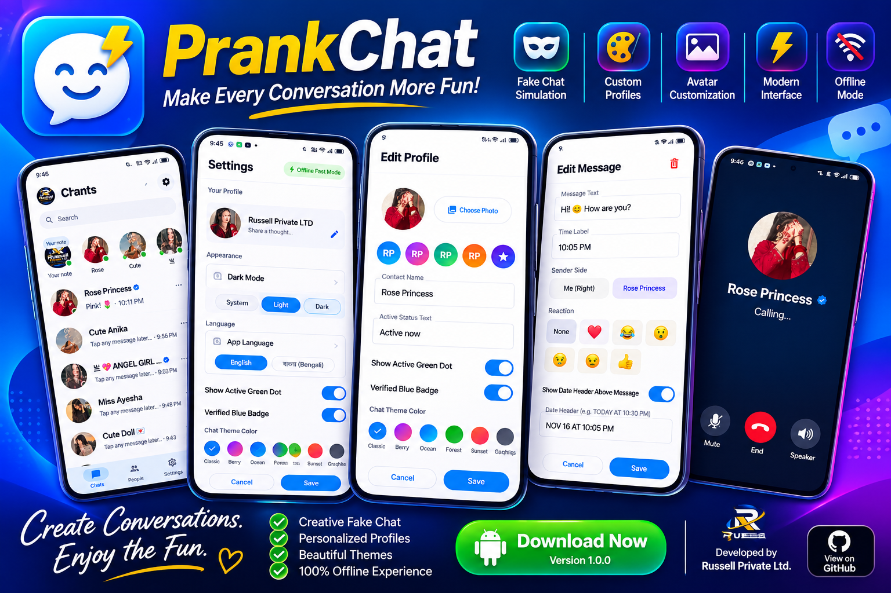

🎭 PrankChat

Make Every Conversation More Fun!

  

  <strong>✨ A Creative Offline Fake Chat Experience for Android ✨</strong>

  
  

  
  
  
  

---

🌟 Welcome to PrankChat!

PrankChat brings creativity and entertainment together in a familiar Messenger-style chat experience.

Create fictional conversations, customize chat profiles, personalize avatars, and build your own imaginary messaging scenarios.

Whether you're creating funny conversations, designing creative chat stories, or simply exploring a simulated messaging experience, PrankChat makes it fun.

Your Conversations. Your Creativity. Your Fun.

🚀 Features That Make It Special

- 🎭 Fake Chat Simulation – Create entertaining fictional conversations.
- 💬 Creative Messaging – Customize messages and chat scenarios.
- 👤 Personalized Profiles – Edit contact names and profile details.
- 🖼️ Custom Avatars – Choose photos or preset avatars.
- 🎨 Beautiful Themes – Customize the chat appearance.
- ✏️ Message Editing – Edit messages, timestamps and reactions.
- 🌙 Dark & Light Mode – Choose your preferred appearance.
- 🌍 Language Support – English and Bengali.
- 💾 Chat Backup & Restore – Export and restore chat history.
- 📴 Offline Experience – Enjoy simulated conversations locally on your device.

📱 App Screenshots

Explore the PrankChat interface and discover its creative features.

📥 Download PrankChat

Ready to create your own fictional conversations?

Latest available version: 1.0.0

  

🔐 Privacy & Transparency

PrankChat is an offline entertainment and chat simulation application.

- Conversations are simulated locally on your device.
- It is not a real messaging service.
- Fictional profiles and conversations are intended for entertainment and creative storytelling.

Please do not present simulated conversations as genuine communications.

🎯 Why PrankChat?

PrankChat combines a familiar chat-inspired interface with creative customization tools.

It's designed for people who enjoy fictional conversations, playful scenarios, and personalized chat experiences.

🛠️ Project Details

Details| Information
Application| PrankChat
Developer| Russell Private Ltd.
Platform| Android
Version| 1.0.0
Category| Entertainment
Internet Requirement| Not required for core offline experience
Repository| GitHub

🔮 What's Next?

The project may receive future improvements, including:

- More interface enhancements
- Additional customization options
- Better user experience
- New creative features

👨‍💻 Developed By

Russell Private Ltd.

Independent Android Application Development.

🌐 GitHub: https://github.com/RussellPrivateLTD

⭐ Support PrankChat

Enjoying the project?

- ⭐ Star this repository.
- 📢 Share PrankChat with friends.
- 💡 Share ideas for future improvements.

Every bit of support helps the project grow!

---

  <strong>🎭 PrankChat</strong>

  <i>Create Conversations. Enjoy the Fun.</i>

  Developed with creativity by <strong>Russell Private Ltd.</strong>

